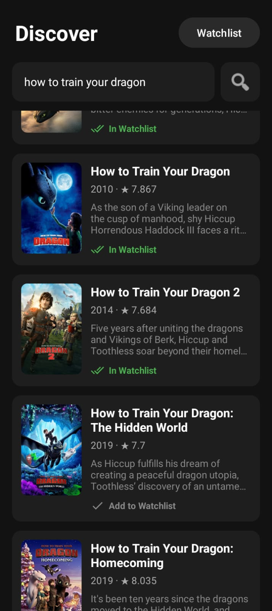
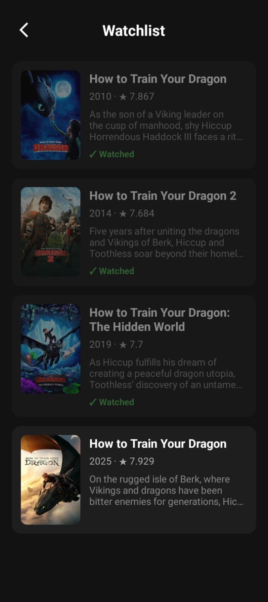

# Movie Watchlist 

A native Android app built with Java and MVVM architecture. Search for movies using the TMDB API, save them to a local watchlist, and track which ones you've watched.

##  Preview

##  Features

- Search movies by title using the TMDB API
- Search with the keyboard's Enter key or the search button
- Keyboard hides automatically after searching
- Tap a movie to save it to your watchlist, with an Undo option
- Save status shown on every card: "Add to Watchlist" or "In Watchlist"
- Mark saved movies as watched or unwatched with a tap
- Long press to delete a movie, with a confirmation dialog
- Watchlist is stored on the device and persists after the app closes
- Immersive full-screen dark UI

## ️ Architecture

The app follows MVVM, so each layer has one job:

| Layer | Class | Job |
|---|---|---|
| View | MainActivity, WatchlistActivity | Display data and handle taps |
| ViewModel | MovieViewModel | Hold UI data, survive rotation |
| Repository | MovieRepository | Combine the network and local data sources |
| Data | Retrofit (TMDB API), Room (local database) | Fetch and store movies |

Data flows down as requests (View → ViewModel → Repository → Retrofit/Room) and back up as LiveData that the Views observe.

##️ Built With

- Java
- Android SDK
- MVVM (ViewModel, LiveData)
- Retrofit and Gson (networking)
- Room (local database)
- Glide (image loading)
- RecyclerView and CardView
- Material Components (Snackbar)
- ExecutorService (background database writes)

##  Concepts Covered

- MVVM with AndroidViewModel and LiveData
- Repository pattern combining a network and a local data source
- Observing data instead of manually refreshing the UI
- Room with LiveData queries and conflict strategies
- Background threading with ExecutorService
- Retrofit with @SerializedName for JSON-to-Java field mapping
- Storing an API key outside source control with BuildConfig
- One RecyclerView adapter reused across two screens
- Handling RecyclerView row reuse correctly
- Immersive mode and keyboard handling

##  Setup

This app needs a free TMDB API key, which is not included in the repo.

1. Get a free API key from [themoviedb.org](https://www.themoviedb.org/settings/api)
2. Add this line to `local.properties` in the project root, with no quotes and no spaces around the `=`: `TMDB_API_KEY=your_key_here`
3. Open the project in Android Studio and click **Sync Now**
4. Run on a device or emulator (API 24+)

## ️ Attribution

This product uses the TMDB API but is not endorsed or certified by TMDB.

##  Author

Abdullah Ashfaq — [@Abdullah-2238](https://github.com/Abdullah-2238)